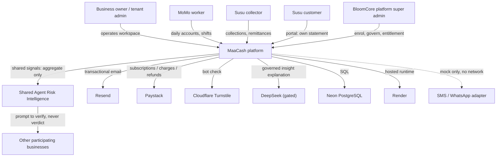
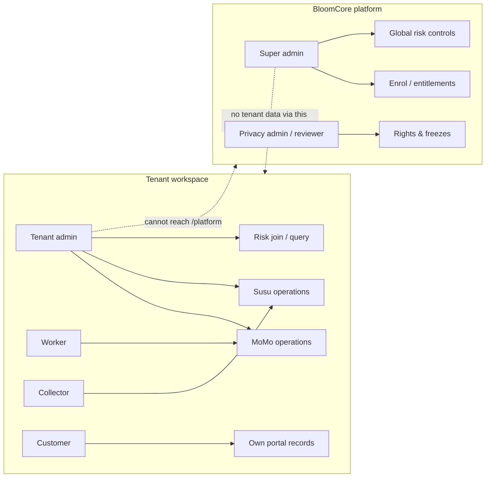
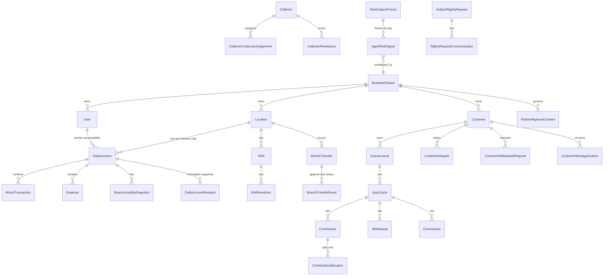
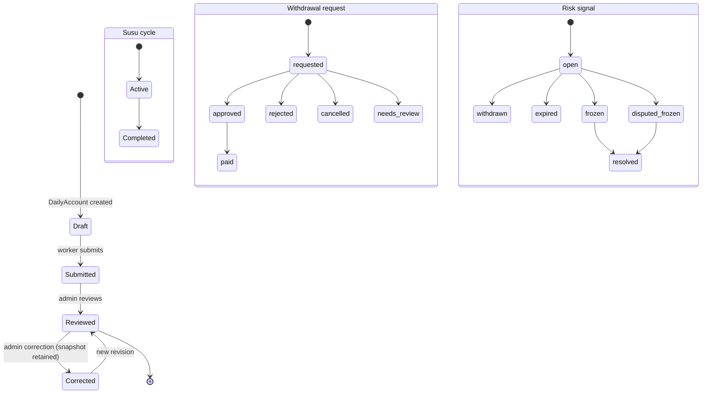
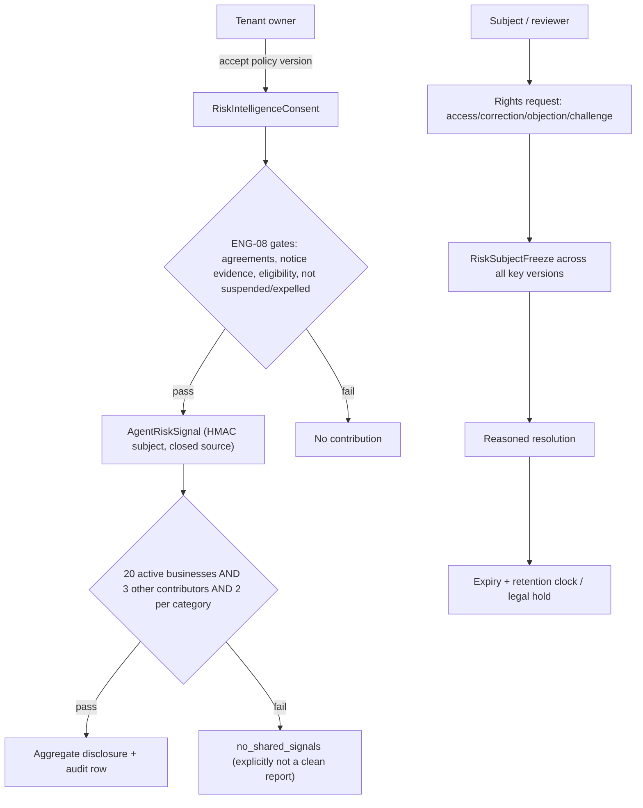

# MaaCash — Confidential Product & Operations Compendium

> **Classification: CONFIDENTIAL — internal product/operations record.**
> Do not copy these facts into global or company-wide documents. Owner: BloomCore Technologies.
> Branch audited: `feat/maacash-momag-readiness` (HEAD `7192f98`, 2026-11-22). `[Verified in live environment]`
> This is a read-only audit. No code, config, test, workflow, production setting or live datum was changed.

## 0. Evidence convention

Every material statement carries exactly one label:

| Label | Meaning used here |
| --- | --- |
| `Verified in code` | Read directly from a source/schema/script file in this repo. |
| `Verified in config` | Read directly from `render.yaml`, `render.staging.yaml`, `.github/workflows/ci.yml`, `package.json` or deployment docs that record configuration. |
| `Verified in live environment` | Confirmed via git/HH branch inspection in this session; other live facts are explicitly qualified. |
| `Approved product rule` | Stated as an approved rule in a controlled document or code comment that names the approval (legal instruments, policy constants, retention schedule). |
| `Assumption` | Supplied baseline or inference. Not independently re-verified. |
| `Unknown` | No reliable evidence found. Owner decision required. |

Local log artifacts are treated as repository artifacts and labelled `Verified in code` with the log path. They are **not** live probes and were **not** re-run.

Verified baseline used throughout: Next.js `16.4.6` + React `19.2.8` (`package.json`); Prisma `7.10.1` with `@prisma/adapter-pg` and `@prisma/adapter-better-sqlite3` (`package.json`, `src/lib/prisma-client.ts`); 69 migration directories (`prisma/migrations/`); Neon PostgreSQL `us-east-2` (`docs/NEON-RENDER-DEPLOYMENT.md`); Render Oregon free plan, 1 instance, custom domain `maacash.bloomcoretech.com`, `APP_ENV=PILOT`, `autoDeploy: true`, health path `/api/health` (`render.yaml`). Stack evidence `Verified in code` (`package.json`, `src/lib/prisma-client.ts`); 69 migrations `Verified in code` (`prisma/migrations/`); infrastructure facts `Verified in config` (`docs/NEON-RENDER-DEPLOYMENT.md`, `render.yaml`). Live `GET https://maacash.bloomcoretech.com/api/health` returned HTTP 200 with `{"status":"ok"}` and `GET /privacy` returned HTTP 200 on 2026-11-25 during this task's read-only probes. `Verified in live environment`. The older `https://maacash.onrender.com/api/health` probe returned 404; the custom domain is the public origin. No write or authenticated request was made.

Test artifacts: unit `1828 passed (1828)` in `.tmp-final-test2.log`; E2E `111 passed / 5 failed / 11 skipped` in `.tmp-e2e-clean.log`. Both `Verified in code` (log artifacts). **E2E did not pass**; do not describe it as green. No tracking/ad pixel in scope. `Assumption` (scope statement supplied; no analytics script found in reviewed files).

---

## 1. Product purpose and boundaries

- MaaCash is a **mobile-money (MoMo), Susu and multi-branch financial operations platform** for enrolled businesses, each in an isolated workspace with its own users, customers, records and history. `Verified in code` (`README.md:1-16,18-25`; `prisma/schema-pg.prisma` `BusinessTenant`).
- Product identity is MaaCash; the first tenant is BIK Prestige Enterprise (`BIK-HQ-001`). BIK is a customer of the platform, not the product name. `Verified in code` (`README.md:14-16`).
- Formerly BloomCore One. Identity changed; platform, data, accounts and financial history did not. `Verified in code` (`README.md:11-12`; `render.yaml:17-19` — JWT audience and OIDC slug intentionally stay `bloomcore-one`).
- Modules: MoMo daily accounts; Susu collections/cycles/withdrawals/remittances; customer portal; platform console. `Verified in code` (`README.md:20-25`).
- **Privacy boundary — two controller roles.** For single-tenant accounting and staff records the participating business is Data Controller and BloomCore is Data Processor. For the Shared Agent Risk Intelligence module, BloomCore and the participating business are Joint Controllers. `Approved product rule` (`src/lib/risk-intelligence/legal-instruments.ts:318-322`; `docs/PRIVACY_SECURITY_AND_DPO_DPS_AUDIT.md`).
- Product boundary: shared risk intelligence is **never a blacklist, public list or search-by-name service**. A disclosure is a prompt to check the caller's own records. `Approved product rule` (`src/lib/risk-intelligence/policy.ts:19-21,161-165`; `legal-instruments.ts:383`).
- Out of scope / not claimed: no real SMS/WhatsApp provider is wired; no external-AI delivery is implemented in this release. `Verified in code` (`src/lib/messaging/provider.ts:3-8,86-90`; `src/lib/zeli/gateway.ts:12-13,251-256`).



## 2. Tenancy, business and branch ownership

- `BusinessTenant` is the ownership root. Nearly every domain model carries `tenantId`; comments state tenant data access resolves tenant from the authenticated server session, never from browser input. `Verified in code` (`prisma/schema-pg.prisma` `BusinessTenant` and model-level comments at lines 1323-1327).
- Tenant lifecycle states: `PROVISIONING | ACTIVE | SUSPENDED | ARCHIVED`; onboarding `NOT_STARTED | IN_PROGRESS | COMPLETED`; per-tenant module switches `momoEnabled`, `susuEnabled`. `Verified in code` (`schema-pg.prisma:1830-1834`).
- `User` belongs to one tenant and one `Location`. `Location` belongs to one tenant; unique `@@unique([tenantId, code])`. `Verified in code` (`schema-pg.prisma:16-59,61-88`).
- A `DailyAccount` is one branch (`locationId`) on one `businessDate`, unique `@@unique([locationId, businessDate])`, owned by a `workerId`. `Verified in code` (`schema-pg.prisma:90-168`).
- `Shift` is a working period at one location/day; a daily account may have several shifts, and **shift figures are never added into daily-account reconciliation** (prevents double counting). `Verified in code` (`schema-pg.prisma:368-417`).
- `CollectorCustomerAssignment` binds a collector to a customer **and** account, unique per `(collectorId, accountId)`. `Verified in code` (`schema-pg.prisma:1142-1163`).
- No cross-tenant relation exists between a platform admin and tenant data: `PlatformSuperAdmin`, `PlatformAuditLog` are separate tables with a separate cookie and guard. `Verified in code` (`schema-pg.prisma:1935-2020`; `src/middleware.ts:56-67,244-287`).
- `BranchTransfer` source and destination are both `Location`, with append-only `BranchTransferEvent` history. `Verified in code` (`schema-pg.prisma:277-366`).

## 3. User types, role hierarchy and privacy grants

Tenant-side primary roles are `admin | worker | collector`; customer is a separate subject type. Module capability is carried in the session (`modules`) and is distinct from the primary role. `Verified in code` (`schema-pg.prisma:22-30`; `src/lib/auth.ts:82-122,453-462`).

| Type | Scope | Key abilities | Evidence |
| --- | --- | --- | --- |
| Platform super admin (`PlatformSuperAdmin`) | Platform-wide, one-way isolated | Enrol tenants, manage Zeli entitlement/availability, privacy grants, governance controls, platform audit | `Verified in code` (`schema-pg.prisma:1935-1961`; `src/middleware.ts:244-287`) |
| Tenant admin (`User.role=admin`) | Own tenant, all modules | MoMo review/corrections; Susu withdrawals; join/withdraw risk intelligence; operational policy | `Verified in code` (`src/lib/tenant.ts:311-333`; `src/lib/actions/risk-intelligence.actions.ts:85,126,192`) |
| MoMo worker (`User.role=worker`, `momoEnabled`) | Own location / own daily accounts | Create and operate daily accounts, shifts, ledger entries | `Verified in code` (`src/lib/auth.ts:663-670`; `src/lib/tenant.ts:334-340`) |
| Susu collector (`User.role=worker` + `susuEnabled` + active `Collector`) | Assigned customers/accounts only | Record contributions, remittances | `Verified in code` (`src/lib/auth.ts:684-707`; `src/lib/tenant.ts:342-348`) |
| Customer (`Customer` record, portal) | Own records only | View statement/payments/withdrawals, raise disputes, withdrawal requests, messages | `Verified in code` (`schema-pg.prisma:754-796`; `src/lib/auth.ts:710-719`) |
| Privacy grants (`RiskPrivacyAccess`) | Global governance, not tenant money | Active roles are `privacy_admin` and `privacy_reviewer`, checked server-side on every operation. The retired `dpo` label survives only in immutable historical rows and grants no authority. | `Verified in code` (`schema-pg.prisma`; `src/lib/actions/risk-governance.actions.ts`; `tests/retired-dpo-role.test.ts`) |
| Association roles | Association/zone only | `association_admin`, `zone_officer`, `member_viewer`, `auditor`; deliberately no authority over a member business's money | `Verified in code` (`schema-pg.prisma:1419-1443`) |

Notes:
- Dual-role accounts keep one primary role; the **module** in the token is the authorization scope. Admin authority is never granted through module capabilities. `Verified in code` (`src/lib/auth.ts:492-500`; `SECURITY.md:96-100`).
- A Susu collector is resolved from a valid Susu module session **plus** an active `Collector` row; `User.role` is deliberately not used. `Verified in code` (`src/lib/auth.ts:684-707`).
- Only a tenant admin may query shared risk signals (`role === "admin"` gate), and join/withdraw actions use `requireTenantAdminMomo`. `Verified in code` (`src/lib/risk-intelligence/policy.ts:199-201`; `risk-intelligence.actions.ts:85,126,192`).
- Tenant privacy admin **cannot** perform global controls, suspension/expulsion, subject freezes, key retirement, notice publication or the retention sweep; these are platform-only. `Verified in code` (`docs/PRIVACY_SECURITY_AND_DPO_DPS_AUDIT.md:127`).
- No counsel, DPIA, DPO or DPS appointment, account, review, signature or approval is required for any onboarding or core-use journey. The retired `dpo` alias grants no permission. `Verified in code` (`docs/privacy/COUNSEL_DPIA_DPO_DPS_REMOVAL_ADDENDUM.md`; `tests/retired-dpo-role.test.ts`).



## 4. End-to-end journeys

1. **MoMo daily close.** Worker opens a `DailyAccount` for a branch/day, records `MomoTransaction` rows and `Expense` rows, optionally works shifts and `ShiftHandover`s, then submits; admin reviews and may record a physical handover / correction. `Verified in code` (`schema-pg.prisma:90-168,170-244,368-462`; `src/lib/actions/daily-account.actions.ts`, `src/lib/actions/momo-ledger.actions.ts`).
2. **Susu contribution.** Collector or office records a `Contribution` against an active `SusuCycle`; amount is split into `ContributionAllocation` rows (one per cycle day) using `daysCovered = amount / dailyContribution`; `referenceId` (`CON-...`) is the idempotency key. `Verified in code` (`src/lib/actions/susu-contribution.actions.ts:209-213,274-276,310-352`; `schema-pg.prisma:997-1054`).
3. **Susu withdrawal.** Tenant admin re-authenticates with own password (single-use step-up grant), commission is claimed once per cycle, balance is recomputed under a row lock, `Withdrawal` is written, and a receipt is queued. `Verified in code` (`src/lib/actions/susu-withdrawal.actions.ts:43-46,118-280`; `schema-pg.prisma:1056-1083`).
4. **Customer portal.** Customer signs in, views own statement, may open a `CustomerDispute` or `CustomerWithdrawalRequest`; office resolves/approves through existing authorised flows. `Verified in code` (`schema-pg.prisma:754-796,891-995,896-924`; `src/lib/actions/customer-dispute.actions.ts`, `withdrawal-request.actions.ts`).
5. **Platform onboarding.** Public `AccountEnquiry` → platform super admin provisions a `BusinessTenant` → admin bootstrap → tenant users created with temporary passwords and forced first login. `Verified in code` (`schema-pg.prisma:2964-2996`; `src/lib/actions/provisioning.actions.ts`, `platform-enquiries.actions.ts`; `SECURITY.md:22-25`).
6. **Shared risk intelligence.** Owner joins with policy version → required agreements executed → employee notice attestation with 14-day lead → administrator contributes a signal from a closed own record → query gates evaluate → disclose aggregate only, with audit. `Verified in code` / `Approved product rule` (`src/lib/risk-intelligence/policy.ts:368-424`; `governance-state.ts:91-165`; `legal-instruments.ts:340`).

```mermaid
sequenceDiagram
  participant W as Worker
  participant SA as Server action
  participant DB as Postgres (tenant-scoped)
  participant A as Tenant admin
  W->>SA: Record MoMo transaction / open shift
  SA->>SA: Resolve module session + tenant from server
  SA->>DB: Insert with tenantId, idempotencyKey
  W->>SA: Submit daily account
  SA->>DB: status submitted
  A->>SA: Review + physical handover count
  SA->>DB: reviewedAt / handover difference
  SA->>DB: Append audit log
  Note over SA,DB: Reconciliation never edits a financial row silently; correction is append-only
```

## 5. Core entities and relationships

Entity inventory is `Verified in code` (`prisma/schema-pg.prisma`). The diagram shows the reliable, directly-relatable core; it omits derived/auxiliary tables rather than guessing relationships.



Key invariants visible in the schema: unique `@@unique([tenantId, reference])` on money-bearing rows; `@@unique([tenantId, idempotencyKey])` on transfers/remittances/offline rows; `@@unique([tenantId, subjectType, subjectId])` on disputes; `@@unique([tenantId, fingerprint])` on anomalies. `Verified in code` (`schema-pg.prisma`, respective models).

## 6. Transaction lifecycle, references and reconciliation

### 6.1 MoMo accountability model

- Two ledger modes: `aggregate` (opening/closing plus manual commission, debts, expenses) and `ledger` (commission, debts, other income and expenses derive from `MomoTransaction`; principal customer movements — cash in/out, airtime — never enter the accountability formula). Mode is set once before any ledger entry; historical aggregate rows are never silently converted. `Verified in code` (`schema-pg.prisma:134-146`).
- Every `MomoTransaction` is an operator-recorded record, never a provider confirmation. `verificationStatus=provider_confirmed` can only be set by an integration, not manual entry. `recordingSource` is always explicit. `Verified in code` (`schema-pg.prisma:170-210`).
- Corrections and reversals are append-only: the superseded row keeps its values and only changes status; successor/reversal rows carry linkage. `Verified in code` (`schema-pg.prisma:178-180,217-232`).
- Provider statement imports are **evidence only**: nothing posts to the MoMo ledger; a matched row only links to an existing internal record. `Verified in code` (`schema-pg.prisma:3263-3268`; `src/lib/provider-statement.ts`).
- Liquidity snapshot keeps declared / adjusted / counted figures separate; variance = counted − adjusted. `Verified in code` (`schema-pg.prisma:3349-3407`).
- Reconciliation exceptions are one queue for statement, liquidity, transfer, remittance, shift and daily-close discrepancies. Resolving a case **never changes a financial record**; the linked correction is recorded by its own authorised workflow and referenced. `Verified in code` (`schema-pg.prisma:3409-3490`).

### 6.2 Susu contribution and commission rules (only where code supports)

- **Commission:** one day's contribution is deducted as commission on the **first withdrawal in a cycle** and resets each new cycle. `Verified in code` (`src/lib/actions/susu-withdrawal.actions.ts:43-46`; `schema-pg.prisma:827-852,1085-1104`).
- Balance = contributions − withdrawals (net) − commissions. `Verified in code` (`susu-withdrawal.actions.ts:30-38,163-180`).
- Commission claim is a single conditional `updateMany(commissionCharged:false → true)` inside the transaction, after `lockAccountForUpdate`; concurrent withdrawals cannot both charge. `Verified in code` (`susu-withdrawal.actions.ts:119-208`).
- `Withdrawal.netAmount` is the amount actually paid; `CustomerWithdrawalRequest.amountPesewa` is integer pesewa. `Verified in code` (`schema-pg.prisma:896-924,1056-1072`).
- Withdrawal amount validation: finite, > 0, ≤ 999999.99, max two decimal places. `Verified in code` (`susu-withdrawal.actions.ts:63-81`).
- Contribution `referenceId` is the idempotency key; an existing reference is refused (`P2002` treated as already processed). `Verified in code` (`susu-contribution.actions.ts:274-276`; `susu-withdrawal.actions.ts:291-301`).
- Card fee defaults to GH₵10 in the schema; it is a recorded fee, not a money movement. `Verified in code` (`schema-pg.prisma:1106-1121`).
- **Unknown:** no code was found that auto-opens/closes a cycle by calendar date; cycle status is set by callers. Owner decision needed.



## 7. Shared Agent Risk Intelligence (governed workflow)

### 7.1 Verified thresholds

`Verified in code` (`src/lib/risk-intelligence/policy.ts:29-36`):

| Constant | Value | Meaning |
| --- | --- | --- |
| `RISK_INTELLIGENCE_MIN_NETWORK` | **20** | Minimum active, eligible `share_signals` businesses before any disclosure |
| `RISK_INTELLIGENCE_MIN_CONTRIBUTORS` | **3** | Minimum distinct **other** businesses reporting the same subject |
| `RISK_INTELLIGENCE_MIN_CATEGORY_CONTRIBUTORS` | **2** | Minimum distinct businesses reporting the same category |
| `RISK_INTELLIGENCE_MIN_CATEGORIES` | 1 | At least one qualifying category |
| `RISK_INTELLIGENCE_DECAY_DAYS` | 180 | Signal expiry from observation end |
| `RISK_INTELLIGENCE_MAX_SIGNALS_PER_SUBJECT` | 12 | Cap on disclosed categories |
| Policy version | `risk-intelligence-policy-2026.12` | Stale version blocks join/query/contribution |

These thresholds are also stated in the lawyer-approved instruments. `Approved product rule` (`legal-instruments.ts:318,381,413`).

### 7.2 Contribution gates (all must hold)

`Verified in code` (`policy.ts:368-424`; `governance-state.ts:91-165`): active consent with `share_signals`; current policy version; executed required agreements; recorded + verified employee notice attestation (14-day lead for existing staff, immediate for portal acknowledgement); business eligibility verified; controller registration checked for information; not suspended, not expelled; global control enabled; good-faith declaration; reason ≥ 10 characters; source points at a **closed own record** with evidence reference; no duplicate `(tenantId, subjectKey, sourceType, sourceId)`.

Identity is a salted **HMAC-SHA256** of normalised name + phone; no national ID, photo or address. Key rotation uses active + supported previous versions; hashes are never regenerated. `Verified in code` (`src/lib/risk-intelligence/hasher.ts:41-89,118-138`). Secrets are provider-injected (environment-backed provider shipped); never in DB, code, logs or audit rows; only metadata is audited. `Verified in code` (`secret-provider.ts:1-12,23-31,94-131`).

### 7.3 Query gates and disclosure content

Denials, in order: `feature_unavailable`, `tenant_unavailable`, `role_not_permitted`, `consent_missing`, `consent_withdrawn`, `policy_version_stale`, `agreement_missing`, `subject_frozen`, `subject_not_known_to_business`, `reason_required`, `insufficient_network`. `Verified in code` (`policy.ts:69-102,190-236`).

- Only live, open, in-category, unexpired, unfrozen, undisputed signals count; caller's own signals never count toward its threshold. `Verified in code` (`policy.ts:238-252`).
- Output carries category label, severity, **coarse band** (`3 to 5`, `6 to 9`, `10 or more`), and month-level observation — never a name, phone, note, source record, contributing business or exact count. Always `requiresHumanJudgement: true`, `isBlacklist: false`, `disclosesIdentity: false`. `Verified in code` (`policy.ts:140-171,292-336`).
- Every disclosure is written to `RiskIntelligenceDisclosure` **before** the caller sees the result. `Verified in code` (`schema-pg.prisma:3589-3612`).

### 7.4 Consent, challenge/correction, retention and audit

- Join is a deliberate owner act at a specific policy version; withdrawal is deliberate, keeps the row marked withdrawn, and stops sharing immediately (own signals set withdrawn). `Verified in code` (`src/lib/actions/risk-intelligence.actions.ts:115-220,578-606`; `schema-pg.prisma:3496-3533`).
- Challenge/objection/complaint_review triggers a fail-closed freeze across all key versions; subject can be resolved only by a reasoned decision. `Verified in code` (`subject-rights.ts:84-97`; `governance-state.ts:167-175`; `schema-pg.prisma:3631-3650`).
- Rights clock: acknowledge within **3 business days** (Ghana calendar, versioned); resolve within **21 calendar days**; one written, reasoned extension up to **14 calendar days** before the original deadline. `Approved product rule` (`subject-rights.ts:4-13,21-23,53-78`; `legal-instruments.ts:322`).
- Retention: active signal 180 days from observation end; expired +90 days; withdrawn +90 days; disputed +90 days after actual resolution (no clock while open); disclosure/RI audit 24 months; legal hold blocks deletion, review 14 days after closure, extension only lawful deferral. `Approved product rule` (`src/lib/risk-intelligence/retention.ts:6-21,56-121`; `docs/PRIVACY_SECURITY_AND_DPO_DPS_AUDIT.md:167-173`).
- Governance evidence: versioned employee notices + attestations, participation agreements bound to exact document hash, scoped legal holds, append-only `RiskControlEvent`, key metadata only, organisation profile with owner-confirmed facts. `Verified in code` (`schema-pg.prisma:3703-3861`).
- **Unknown:** actual execution state of any specific agreement/attestation in the live tenant. Owner decision required.



## 8. Authentication, permissions, session lifecycle, recovery

- Passwords bcrypt cost 12; min 8 chars, uppercase, number (documented policy). `Verified in code` (`src/lib/auth.ts:140-149`; `SECURITY.md:11-15`).
- JWTs HS256, issuer `bloomcore-one`, audiences `bloomcore-one:session`, `bloomcore-one:workspace-selection`, `bloomcore-one:platform`; payload carries `jti`, `tokenVersion`, `amr`, module. `Verified in code` (`src/lib/auth.ts:93-190`).
- Production transport is the `x-bloomcore-tab-session` header injected by a same-origin service worker; **no auth cookie is issued or trusted in production**. A copied URL in a new tab does not transfer authentication. `Verified in code` (`src/lib/auth.ts:60-80,318-353`; `src/middleware.ts:149-164`).
- Module-scoped tokens (`admin | momo | susu | customer`) plus a one-way isolated platform boundary; `/platform/*` accepts only `kind:"platform"` claims. `Verified in code` (`src/middleware.ts:244-287,375-495`).
- Session registry: a JWT is accepted only while its `jti` `SessionRecord` exists, is unexpired and unrevoked. `tokenVersion` bumps and forced-password-reset flags invalidate old sessions. `Verified in code` (`schema-pg.prisma:2068-2139`; `src/lib/auth.ts:552-604`; `src/lib/security/session-store.ts`).
- Timeouts are **server-enforced** from `SESSION_POLICY`. Production config: idle 900s, background 300s, absolute 28800s (`render.yaml:87-94`). Code defaults are more generous (idle 28800, background 7200, absolute 28800) when env is absent. `Verified in code` / `Verified in config`.
- MFA: `MFA_ENFORCEMENT=enforce` in production; only `amr=pwd+mfa` sessions pass. `Verified in config` (`render.yaml:69-70`; `src/lib/security/config.ts:161-175`; `src/lib/auth.ts:562-563`).
- Turnstile fail-closed on login/recovery-style protected submissions; enabled in production. `Verified in config` / `Verified in code` (`render.yaml:71-78`; `src/lib/security/turnstile.ts:6-15`).
- Abuse controls are DB-backed keyed HMAC identifiers only: `RateLimitCounter`, `AuthThrottle` (1→5→15 min), `TurnstileTokenUse`. `Verified in code` (`schema-pg.prisma:2025-2066`).
- Account recovery is **administrator-assisted**: a tenant admin issues a single-use code to a user in their own tenant; a platform admin may assist tenant admins; plaintext shown once, only SHA-256 hash stored, 30-minute TTL, all sessions revoked on use. `Verified in code` (`src/lib/actions/account-recovery.actions.ts:26-38`; `schema-pg.prisma:2148-2168`).
- Inconsistency: `SECURITY.md:34-41` documents 5-minute idle / 15-minute absolute and cookie transport, which conflicts with production config and current code. Treat `SECURITY.md` session section as stale. `Verified in code` / `Verified in config`.

## 9. Integration contracts (no secrets)

| Integration | Auth method | Failure handling | Evidence |
| --- | --- | --- | --- |
| Resend (transactional email) | `RESEND_API_KEY` Bearer from env; sender from `EMAIL_FROM_SECURITY`/`EMAIL_FROM`; sender must be verified domain; privacy Gmail is contact, never sender | Missing key/sender → `ok:false`; HTTP 429/5xx → retryable; timeouts → retryable; provider body never logged/stored; production preflight fails deploy if unconfigured/disabled | `Verified in code` (`src/lib/email/resend.ts:38-51,118-174`; `render.yaml:58-63`) |
| Paystack (subscriptions, MoMo charge, refunds) | `PAYSTACK_SECRET_KEY` (server-only) Bearer; fixed `https://api.paystack.co`; webhook HMAC-SHA512 legacy header and `Paystack-Signature` with `whsec_` rotation, 300s tolerance | Distinguishes definite rejection (400/401/403/404/422 without duplicate hint) from **ambiguous** (409, timeout, malformed, 5xx) → reconciliation required; bounded 256KB response, 20s timeout, sanitized provider messages; `pay_offline` never treated as paid; refund only `processed` when Paystack says so; no caller-supplied URL | `Verified in code` (`src/lib/payments/paystack.ts:24-26,78-94,213-273,417-571,592-727`) |
| Cloudflare Turnstile | `TURNSTILE_SECRET_KEY` + site key; verifies token, hostname allow-list (`maacash.bloomcoretech.com`), action, age ≤ 10 min, single-use `TurnstileTokenUse` ledger with idempotency_key | Fail closed: missing token/secret/timeout/mismatch/replay all reject; exactly one safe retry after transport failure; no secrets/tokens logged | `Verified in config` / `Verified in code` (`render.yaml:71-78`; `src/lib/security/turnstile.ts:6-15,107-204`) |
| DeepSeek / Zeli (AI insight explanation) | `DEEPSEEK_API_KEY` Bearer; fixed `https://api.deepseek.com/chat/completions`; only allow-listed aggregate insight package; global `ZeliProviderControl` + per-tenant authorization + code approval required | `EXTERNAL_AI_PHASE` disabled → gateway hard-denies and audits; strict Zod output schema + forbidden-output regex (no numbers/emails/URLs/IDs); bounded 256KB, 25s timeout; no prompts/payloads stored in audit | `Verified in code` (`src/lib/zeli/deepseek-client.ts:9-21,62-93,107-208`; `src/lib/zeli/gateway.ts:10-26,245-304`; `schema-pg.prisma:2622-2678`) |
| WhatsApp / SMS (customer receipts) | **Mock adapter only**; `MockMessageProvider.delivers=false`, returns `simulated`; tenant switches and approved templates gate delivery; opt-in/verification records exist | No network connection; never reports `sent`; tenant switch can only narrow platform ceiling; unapproved template refuses; E.164 validated, phone masked | `Verified in code` (`src/lib/messaging/provider.ts:3-8,63-90`; `src/lib/messaging/config.ts:1-8,136-239`; `schema-pg.prisma:3088-3257`) |
| Neon PostgreSQL | `DATABASE_URL` (pooled) + `DIRECT_URL` (unpooled) from Render dashboard; `@prisma/adapter-pg`; migrations applied by explicit `prisma migrate deploy`, never by build | Region mismatch Oregon (web) vs `us-east-2` (DB) documented as readiness risk; restore into new branch/database, never in place | `Verified in config` / `Verified in code` (`render.yaml:52-55,21-23`; `src/lib/prisma-client.ts:20-25`; `docs/NEON-RENDER-DEPLOYMENT.md:301-314`) |
| Render | `render.yaml` blueprint; `NODE_ENV=production`, `APP_ENV=PILOT`, `autoDeploy:true`, health `/api/health`; secrets `sync:false` in dashboard only | Build does not create/alter schema; former `bloomcore-one` service deleted; `maacash.onrender.com` transition-only | `Verified in config` (`render.yaml:1-40`; `src/app/api/health/route.ts:1-22`) |

`ZELI_EXPIRY_SCHEDULER=disabled` on the new service reported in `docs/deployment/MAACASH-NEW-RENDER-SERVICE-REPORT.md:185-191`. `Verified in config`.

## 10. Data classification, retention, audit, backup/recovery

- **Sensitive:** password hashes (bcrypt), TOTP secrets (AES-256-GCM encrypted), recovery-code hashes, reset/verification token hashes, risk subject HMAC keys, customer phone/email, money rows. **Security control tables persist keyed HMAC identifiers only** — never raw email, IP or token. `Verified in code` (`schema-pg.prisma:16-59,1222-1260,2025-2066,2863-2899,3819-3831`).
- Audit trails are split: tenant `AuditLog` (with actor snapshot name/role so history survives rename/removal) vs `PlatformAuditLog` (plain-string tenantId so history survives tenant archival). Financial/business audit is never touched by security-event retention. `Verified in code` (`schema-pg.prisma:725-748,1997-2020,2878-2881`).
- Retention: security events 365 days; risk signals per §7.4; agreement/authority evidence 6 years; training evidence per course settings. `Verified in code` / `Approved product rule` (`schema-pg.prisma:2878-2881`; `docs/PRIVACY_SECURITY_AND_DPO_DPS_AUDIT.md:167-173`; `schema-pg.prisma:1449-1464`).
- Backup/recovery: Neon point-in-time restore and own `pg_dump` archives are documented; restore into a new Neon branch/database, never in place. `Verified in config` (`docs/NEON-RENDER-DEPLOYMENT.md:301-314`; `PRODUCTION-RELEASE-RUNBOOK.md:57`).
- On 2026-11-25 a pre-migration Neon snapshot `snap-sweet-darkness-b4kclz8q` (`maacash-pre-migration-20261125`) was created and confirmed; all 30 pending additive migrations were applied once and `prisma migrate status` later reported "Database schema is up to date!" with existing records preserved. `Verified in live environment`. No restore drill was performed in this audit; restore readiness remains `Unknown`.

## 11. Scheduled jobs

None are provisioned as Render cron jobs. Owner rejected the USD 1/month cron charge; retention and rights-deadline review are manual. `Verified in config` (`docs/PRODUCTION_ENVIRONMENT_CONFIGURATION.md:130-145`; `docs/PRODUCTION_RELEASE_REPORT.md:44-45`; `docs/deployment/MAACASH-NEW-RENDER-SERVICE-REPORT.md:185-187`).

Prepared triggers (all bearer-token gated; `503` when unconfigured, `403` when wrong token):

| Job | Entry point | Auth env var | Evidence |
| --- | --- | --- | --- |
| Risk retention sweep | `scripts/run-risk-retention-cron.mjs` → `POST /api/internal/risk-intelligence/retention` | `RISK_RETENTION_TOKEN` + `MAACASH_APP_URL` (HTTPS-only, 30s timeout) | `Verified in code` |
| Zeli lifecycle expiry | `npm run zeli:expire` → `expireZeliLifecycle()` | local/CLI, not an endpoint | `Verified in code` (`scripts/zeli-expire.ts`) |
| Anomaly scan | `POST /api/internal/anomaly/scan` | `ANOMALY_SCAN_TOKEN` | `Verified in code` |
| Messaging dispatch | `POST /api/internal/messaging/dispatch` | `MESSAGING_DISPATCH_TOKEN` | `Verified in code` |

`Verified in code` for all four (`src/app/api/internal/**/route.ts`; `package.json:22`).

## 12. Invariants (must hold)

1. Tenant ID always resolved server-side from session; browser-supplied tenant/user/role never accepted. `Verified in code` (`src/lib/auth.ts:435-451`; `schema-pg.prisma:1323-1327`).
2. Platform and tenant boundaries are one-way isolated. `Verified in code` (`src/middleware.ts:244-287`).
3. No module capability grants admin authority. `Verified in code` (`SECURITY.md:96-100`).
4. Money state transitions are append-only; corrections/reversals reference the original. `Verified in code` (`schema-pg.prisma:178-180`).
5. One commission per cycle, claimed conditionally under lock. `Verified in code` (`susu-withdrawal.actions.ts:182-208`).
6. Idempotency keys are tenant-scoped and unique; duplicate submission returns the original or is refused. `Verified in code` (`schema-pg.prisma:234-236,343-344,1175-1178`; `paystack.ts:417-571`).
7. Shared risk: 20/3/2 gates, no identity, no blacklist, every disclosure audited, fail-closed on freeze. `Verified in code` / `Approved product rule` (`policy.ts`).
8. External AI delivery is off by default; payload allow-list suppresses small cohorts. `Verified in code` (`gateway.ts:99-104,245-274`).
9. No secrets, tokens, real customer data or raw provider bodies in logs/audit/UI. `Verified in code` (`resend.ts:1-6,153-168`; `paystack.ts:56-76`).
10. Build never creates or alters schema. `Verified in config` (`render.yaml:21-23`).

## 13. Limitations, unknowns and owner decisions

1. **E2E suite is not green** (5 failures in `.tmp-e2e-clean.log`). Do not claim production readiness from the unit result. `Verified in code` (log).
2. **No production cron** — retention, rights deadlines, anomaly scan and message dispatch are manual/on-request. `Verified in config`.
3. **SMS/WhatsApp delivery is mock-only.** A real provider contract, credentials, opt-in verification and delivery monitoring are required. `Verified in code`.
4. **External AI production mode is disabled** by code approval + environment gates; no payload leaves via the gateway in this release. `Verified in code`.
5. **Stale security doc** (`SECURITY.md` session section) conflicts with production config. Owner should reconcile. `Verified in code` / `Verified in config`.
6. **Live facts re-probed in this task**: health/privacy `200` and migration status `Verified in live environment`; backup restore drill remains `Unknown`. `Verified in live environment` / `Unknown`.
7. **Legal execution state** of specific participation agreements and DPC registration is `Unknown`. The registered office was owner-confirmed on 2026-11-25 and configured in the Render managed environment (presence verified, value not in Git and not in the blueprint); the blueprint correctly keeps `BLOOMCORE_REGISTERED_ADDRESS` as `sync:false`. `Verified in live environment` for presence, `Unknown` for agreement execution state (`render.yaml:102-110`).
8. **Cycle auto-close rule** and any scheduled statement delivery model are `Unknown`; owner decision required.
9. **Account recovery comment says "No email provider is configured"** while Resend adapter exists. Reconcile intent (admin-issued code vs email-assisted) with owner. `Verified in code` (`account-recovery.actions.ts:29`; `src/lib/email/resend.ts`).
