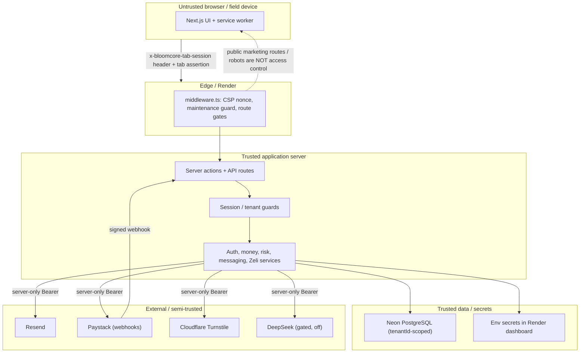
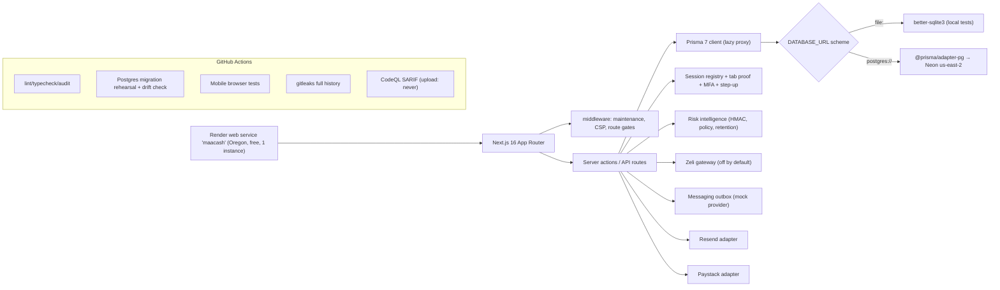

# MaaCash — Security Profile (read-only audit)

> **Classification: INTERNAL — security record.**
> Branch `feat/maacash-momag-readiness`, HEAD `7192f98`. `Verified in live environment`
> Standard: BloomCore Secure Engineering & Real-World Quality Standard v1.0 (`BC-SEC-STD-001`).
> Method: source/config/doc inspection only. No code, config, test, workflow, production setting or live datum changed. No push, merge or deploy. No secrets or personal/customer data reproduced.

## 0. Label and status convention

Statement labels: `Verified in code`, `Verified in config`, `Verified in live environment`, `Approved product rule`, `Assumption`, `Unknown`.

Finding status labels: `verified`, `likely`, `unverified`, `false positive`.

Local logs are repository artifacts: unit `1828 passed` (`.tmp-final-test2.log`), E2E `111 passed / 5 failed / 11 skipped` (`.tmp-e2e-clean.log`). Both `Verified in code` (artifact). **E2E failed; the suite is not green.** Live `GET https://maacash.bloomcoretech.com/api/health` returned HTTP 200 with `{"status":"ok"}` and `GET /privacy` returned HTTP 200 on 2026-11-25 during read-only probes. `Verified in live environment`. The legacy `maacash.onrender.com/api/health` path returned 404. No write or authenticated request was made.

## 1. Scope, assets and trust boundaries

Protected assets: tenant-scoped money and customer records (`Contribution`, `Withdrawal`, `Commission`, `MomoTransaction`, `Customer`), platform/tenant identity and sessions, Shared Agent Risk Intelligence subject hashes and disclosures, audit trails, integration credentials. `Verified in code` (`prisma/schema-pg.prisma`).

Trust rules:
- Browser-supplied role, tenant ID, user ID, collector ID and money values are never accepted as authority. `Verified in code` (`src/lib/auth.ts:435-451,684-707`; `src/lib/tenant.ts:99-204`).
- External provider responses are untrusted: Paystack errors classified `rejected` vs `ambiguous`, checkout URL allow-listed, response body bounded and sanitised; Turnstile verified server-side with hostname/action/age/replay checks; DeepSeek output schema-validated with forbidden-output patterns. `Verified in code` (`src/lib/payments/paystack.ts`; `src/lib/security/turnstile.ts`; `src/lib/zeli/deepseek-client.ts`).
- Platform boundary is one-way isolated from tenant workspaces. `Verified in code` (`src/middleware.ts:56-67,244-287`).
- Crawler directives are not access control: `robots.ts`/`sitemap.ts` exist; private paths are protected by server-side guards, not by robots. `Verified in code` (`src/app/robots.ts`, `src/middleware.ts:497-500`).

## 2. Container architecture

`Verified in config` (`render.yaml`; `.github/workflows/ci.yml`; `package.json`; `src/lib/prisma-client.ts`).

## 3. Authentication, session and authorisation controls

| Control | Implementation | Evidence |
| --- | --- | --- |
| Password hashing | bcrypt cost 12; policy min 8 + uppercase + number | `Verified in code` (`src/lib/auth.ts:140-149`; `SECURITY.md:11-15`) |
| JWT | HS256, issuer `bloomcore-one`, scoped audiences; `jti`, `tokenVersion`, `amr`, module | `Verified in code` (`src/lib/auth.ts:93-190`) |
| Transport | Production uses `x-bloomcore-tab-session` header from service worker; cookies only in test bridge | `Verified in code` (`src/lib/auth.ts:60-80,318-353`; `src/middleware.ts:149-164`) |
| Server session registry | JWT accepted only while `SessionRecord` exists, unexpired, unrevoked; `tokenVersion` bump invalidates | `Verified in code` (`schema-pg.prisma:2068-2139`; `src/lib/auth.ts:552-604`) |
| Timing | Idle / background / absolute enforced server-side; production 900s / 300s / 28800s | `Verified in config` / `Verified in code` (`render.yaml:87-94`; `src/lib/auth.ts:40-58,241-256`) |
| MFA | `MFA_ENFORCEMENT=enforce`; only `amr=pwd+mfa` accepted | `Verified in config` / `Verified in code` (`render.yaml:69-70`; `src/lib/auth.ts:562-563`) |
| Module scope | `admin | momo | susu | customer`; dual-role token bound to one module | `Verified in code` (`src/lib/auth.ts:453-462,492-500`) |
| Guards | `requireAuth/Admin/Worker/Collector/Customer`; tenant context + entity assertions | `Verified in code` (`src/lib/auth.ts:643-719`; `src/lib/tenant.ts:255-440`) |
| Step-up | Single-use `StepUpGrant`, hash-only token, bound to session/purpose/amount/context | `Verified in code` (`schema-pg.prisma:2841-2861`; `src/lib/actions/susu-withdrawal.actions.ts:118-135`) |
| Bot check | Turnstile fail-closed on protected submissions | `Verified in config` / `Verified in code` (`render.yaml:71-78`; `src/lib/security/turnstile.ts`) |
| Abuse controls | DB `RateLimitCounter`, `AuthThrottle` 1→5→15 min, keyed HMAC only | `Verified in code` (`schema-pg.prisma:2025-2066`) |
| CSRF | Same-origin service-worker transport, `SameSite=Lax` test cookies, server actions POST + origin checks | `Verified in code` (`src/middleware.ts:224-233`; `SECURITY.md:130-136`) |
| Account recovery | Admin-issued single-use code, SHA-256 hash only, 30-min TTL, sessions revoked on use | `Verified in code` (`src/lib/actions/account-recovery.actions.ts:26-38`; `schema-pg.prisma:2148-2168`) |

## 4. Server-authoritative money and business invariants

- Tenant ID resolved from session; `assertTenantEntity` re-checks object ownership. `Verified in code` (`src/lib/tenant.ts:378-440`).
- Money state changes occur in `$transaction` with row locks (`lockAccountForUpdate`) and conditional updates; duplicates blocked by unique idempotency keys. `Verified in code` (`src/lib/actions/susu-withdrawal.actions.ts:119-239`; `src/lib/db-lock.ts`).
- One commission per Susu cycle, claimed via `updateMany(commissionCharged:false)`; balance recomputed inside the transaction. `Verified in code` (`susu-withdrawal.actions.ts:182-223`).
- Provider statement imports and reconciliation cases never post or edit financial rows; linked corrections use their own authorised workflow. `Verified in code` (`schema-pg.prisma:3263-3268,3409-3416`).
- Corrections, reversals and transfers are append-only with immutable event/snapshot history. `Verified in code` (`schema-pg.prisma:178-180,351-366,1197-1216`).
- Shared risk: 20/3/2 thresholds, no identity, fail-closed freeze, disclosure audit. `Verified in code` / `Approved product rule` (`src/lib/risk-intelligence/policy.ts:29-36,190-336`).
- Maker-checker `FinancialApproval` and platform `PlatformApprovalRequest` exist for high-impact operations. `Verified in code` (`schema-pg.prisma:2923-2962`).

## 5. Integration security (no secrets)

| Provider | Auth / verification | Failure posture | Evidence |
| --- | --- | --- | --- |
| Resend | Env API key Bearer; verified sender domain | Missing config fails; 429/5xx/timeouts retryable; body never logged/stored; production preflight throws | `Verified in code` (`src/lib/email/resend.ts`) |
| Paystack | Server-only secret key; new `Paystack-Signature` HMAC-SHA512 with `whsec_` rotation + legacy HMAC fallback; 300s tolerance | Ambiguous vs definite rejection; 409/timeout/duplicate hint → reconcile; fixed endpoint, bounded body, sanitized errors, trusted checkout URL only | `Verified in code` (`src/lib/payments/paystack.ts`) |
| Cloudflare Turnstile | Secret + site key; hostname `maacash.bloomcoretech.com`, action, ≤10 min age, single-use ledger | Fail closed; one safe transport retry; no replay | `Verified in code` / `Verified in config` (`src/lib/security/turnstile.ts`; `render.yaml`) |
| DeepSeek / Zeli | Env key Bearer; allow-listed aggregate package; global control + per-tenant authorisation + code approval | Gateway hard-denies while external AI disabled; strict schema; no prompt/payload audit storage | `Verified in code` (`src/lib/zeli/gateway.ts`, `deepseek-client.ts`, `provider-control.ts`) |
| SMS / WhatsApp | **Mock adapter, `delivers=false`** | Returns `simulated`; no network; no delivery claimed | `Verified in code` (`src/lib/messaging/provider.ts`) |
| Neon / Render | Pooled + direct URLs from dashboard; migrations by explicit `prisma migrate deploy` | Region mismatch documented; restore to new branch only | `Verified in config` (`render.yaml`; `docs/NEON-RENDER-DEPLOYMENT.md`) |

Secrets live in the Render dashboard (`sync:false`) and scheduler secret store. CI uses clearly synthetic values. `Verified in config` (`render.yaml:51-118`; `.github/workflows/ci.yml:47-51,83-86`). Gitleaks scans full history; CodeQL SARIF is uploaded as artifact with `upload: never` (code scanning not enabled on the repository). `Verified in config` (`ci.yml:160-216`).

## 6. Data classification, retention and audit

| Class | Examples | Controls | Evidence |
| --- | --- | --- | --- |
| Secret | API keys, HMAC salts, TOTP/MFA keys, JWT secret | Env/dashboard only, never DB/code/logs; key metadata only | `Verified in code` (`src/lib/risk-intelligence/secret-provider.ts`) |
| Sensitive identity | Phone/email, subject HMAC, recovery/reset hashes | HMAC/hash, masking (`maskPhone`), no raw identifier in audit or shared disclosure | `Verified in code` (`hasher.ts`; `src/lib/messaging/provider.ts:42-47`) |
| Financial | Contributions, withdrawals, commissions, ledger rows | Tenant scope, idempotency, append-only corrections, step-up, maker-checker | `Verified in code` (schema + actions) |
| Audit | `AuditLog`, `PlatformAuditLog`, `SecurityEventRecord`, `RiskControlEvent` | Split boundaries, actor snapshots, 365-day security-event retention; financial audit untouched | `Verified in code` (`schema-pg.prisma:725-748,1997-2020,2878-2881,3801-3817`) |
| Governance | Notices, agreements, attestations, legal holds, rights cases | Version + SHA-256 bound, 6-year agreement schedule, retention clock, legal hold | `Approved product rule` (`docs/PRIVACY_SECURITY_AND_DPO_DPS_AUDIT.md:167-173`; `retention.ts`) |

Application-level encryption of notes is **not implemented**; database/backup access remains high risk. `Verified in code` (`docs/PRIVACY_SECURITY_AND_DPO_DPS_AUDIT.md:236`). Live backup verification is `Unknown` (same doc, lines 259-260).

## 7. DDoS / WAF / bot / application abuse — separate coverage

- Bot challenge: Cloudflare Turnstile enforced server-side on protected submissions. `Verified in config` / `Verified in code` (`render.yaml:71-78`; `turnstile.ts`).
- DDoS network/volumetric provider coverage: `Unknown`. No WAF, rate-limit-at-edge or DDoS provider configuration was found in the reviewed files. Do not infer protection from Turnstile.
- WAF: `Unknown`. No WAF rule set in repo.
- Application-level abuse: DB-backed fixed-window rate limiting, progressive auth throttle, step-up, idempotency, tenant/entity assertions, body-size caps and timeouts. `Verified in code` (`schema-pg.prisma:2025-2066`; `src/lib/security/rate-limit.ts`; `paystack.ts:25-26,201-211`; `deepseek-client.ts:19-20`).
- No volumetric, destructive or stress testing was run; production was not scanned. Scope restriction observed.

## 8. Realistic abuse cases (test prompts, not passed tests)

For each: expected server behaviour is given; actual production behaviour is `Unknown` unless cited.

1. **Double-click withdrawal**: unique `referenceId` + conditional commission claim + row lock → one withdrawal, one commission. `Verified in code` (`susu-withdrawal.actions.ts`); live behaviour `Unknown`.
2. **Two tabs / copied URL**: tab-scoped header plus per-tab credential and `SessionRecord`; new tab has no mapping. `Verified in code` (`src/lib/auth.ts:60-80`; `src/lib/security/tab-session.ts`).
3. **Stale data / refresh**: `tokenVersion`, forced-reset flags, server timing and session registry reject stale sessions. `Verified in code` (`auth.ts:552-604`).
4. **Wrong role**: module guard + `role==="admin"` risk query gate + `requireTenant*` guards. `Verified in code` (`auth.ts:643-719`; `policy.ts:199-201`).
5. **Cross-tenant IDOR/BOLA**: `assertTenantEntity` and `tenantId` filters on every money read/write; platform/tenant one-way isolation. `Verified in code` (`tenant.ts:378-440`; `middleware.ts:244-287`). Dedicated tests exist in `tests/tenant-isolation.test.ts` (`Verified in code`); results in `.tmp-final-test2.log` `Verified in code` (artifact).
6. **Duplicate/out-of-order webhook**: unique `eventId` ledger, signature verification with rotation, ambiguous classification. `Verified in code` (`schema-pg.prisma:2527-2548`; `paystack.ts:417-571`).
7. **Malformed/large/Unicode input**: Zod schemas, amount validation, bounded provider bodies, sanitized error messages. `Verified in code` (`susu-withdrawal.actions.ts:63-81`; `paystack.ts:56-76,201-211`; `gateway.ts:55-86`).
8. **Signal challenge**: freeze across all key versions, fail-closed query, reasoned resolution and retention clock. `Verified in code` / `Approved product rule` (`governance-state.ts:167-175`; `subject-rights.ts`).

## 9. CI gates and verification evidence

`Verified in config` (`.github/workflows/ci.yml`):

| Job | Gate |
| --- | --- |
| `sqlite-verify` | lint, typecheck, `npm audit --audit-level=critical`, unit tests, production build |
| `postgres-verify` | migration deploy on disposable Postgres 16, `migrate status`, `migrate diff --exit-code`, PG integration tests |
| `mobile-browser` | Playwright mobile-chromium project |
| `secret-scan` | ignore checks + gitleaks full reachable history, redacted |
| `codeql` | analyse, SARIF artifact, `upload: never` (code scanning disabled) |

Results: unit `1828 passed` (`.tmp-final-test2.log`), E2E `111 passed / 5 failed / 11 skipped` (`.tmp-e2e-clean.log`), both `Verified in code` (artifact). Not re-run in this audit. No production deploy, migration, push or merge performed.

## 10. Findings register

| ID | Severity | Finding | Status | Evidence | Realistic impact | Recommended fix / owner | Regression / verification |
| --- | --- | --- | --- | --- | --- | --- | --- |
| F-01 | High (release) | E2E suite has 5 failures | `verified` | `.tmp-e2e-clean.log`; failures in policy, reconciliation, branch liquidity, step-up withdrawal specs | Release readiness cannot be claimed; a step-up withdrawal workflow failed in browser | Owner: triage 5 failures, fix, re-run clean E2E before any release gate | Re-run `npm run test:e2e`; require 0 failures |
| F-02 | Medium | No provisioned schedulers; retention, rights deadlines, anomaly scan, message dispatch are manual/on-request | `verified` | `docs/PRODUCTION_ENVIRONMENT_CONFIGURATION.md:130-145`; `docs/PRODUCTION_RELEASE_REPORT.md:44-45`; internal routes gated by bearer tokens | Signals/audits not scrubbed on time; rights clocks can breach; cases go stale | Owner: approve spend and provision cron, or accept documented manual runbook with named owner | Verify scheduled run logs and retention counts |
| F-03 | Medium | SMS/WhatsApp delivery is mock-only (`delivers=false`) | `verified` | `src/lib/messaging/provider.ts` | Customers receive no real receipts; product promise vs reality gap | Owner: approve provider contract, credentials, opt-in verification, delivery monitoring | Test success/rejection/timeout/duplicate webhook with synthetic numbers |
| F-04 | Medium | Application-level encryption of notes not implemented | `verified` | `docs/PRIVACY_SECURITY_AND_DPO_DPS_AUDIT.md:236` | DB/backup compromise exposes note content | Owner: decide classification and encryption-at-rest/in-field scope | Re-test with synthetic data; verify key handling |
| F-05 | Low | `SECURITY.md` session section stale (5m/15m, cookie transport) vs production 900s/28800s and header transport | `verified` | `SECURITY.md:27-59`; `render.yaml:87-94`; `src/lib/auth.ts` | Operators rely on wrong policy during incident response | Owner: update `SECURITY.md` to match code/config | Doc review in release checklist |
| F-06 | Low | DDoS/WAF coverage `Unknown`; Turnstile is bot-only | `unverified` | Absence of config in reviewed files; `turnstile.ts` is challenge verification | Volumetric or WAF-layer attack handling not established | Owner: document provider coverage or explicitly accept risk | Provider configuration review, not a production stress test |
| F-07 | Low | Render Oregon vs Neon `us-east-2` region mismatch | `verified` | `docs/NEON-RENDER-DEPLOYMENT.md:314`; `docs/PERFORMANCE_AND_LOAD_TEST_REPORT.md:13` | Added latency; cross-region data path | Owner: accept or relocate with approved migration | Re-run baseline performance test in staging |
| F-08 | Low | CodeQL SARIF uploaded as artifact with `upload: never`; code scanning not enabled | `verified` | `.github/workflows/ci.yml:205-216` | Static findings not centrally enforced as a gate | Owner: decide whether to enable code scanning | Review SARIF artifact per release |
| F-09 | Info | CSP still report-only / `unsafe-inline` documented exception | `verified` | `SECURITY.md:102-123`; `src/lib/security/csp.ts`; `middleware.ts:224-233` | Known XSS defence-in-depth gap | Owner: plan enforced CSP after compatibility check | CSP report review in staging |
| F-10 | Info | Backup restore drill not performed in this pass; migration status verified earlier in the session but not re-probed | `unverified` for restore; `verified` for migration status | `prisma migrate status` reported "Database schema is up to date!" earlier on 2026-11-25; no restore drill evidence found | Unknown restore readiness; possible drift between repo and live deployment | Owner: schedule a restore drill with approved scope | Record exact commands/results in release report |

No `false positive` findings were identified in this pass. Findings F-01–F-10 are documentation/process observations; no new exploit was demonstrated.

## 11. Release-gate recommendation

1. **Do not deploy or merge from this branch** on the strength of this audit. F-01 is open. `verified`.
2. Owner must approve: scheduler spend (F-02), real messaging provider (F-03), note-encryption scope (F-04), stale-doc correction (F-05), DDoS/WAF position (F-06).
3. Green unit tests are **not** proof of security or production readiness. What was tested: unit suite, migration rehearsal/disposable-Postgres integration, lint/typecheck/audit, secret scan, CodeQL analysis, and a browser run that **failed 5 tests**. Not tested in this pass: live endpoints, production backup restore, WAF/DDoS behaviour, real provider integrations, tenant/role abuse against production. `Verified in config` / `Assumption`.
4. Required next step: clean E2E run, owner sign-off on F-02–F-06, then a separately approved production release. No command in this audit changed production state.
