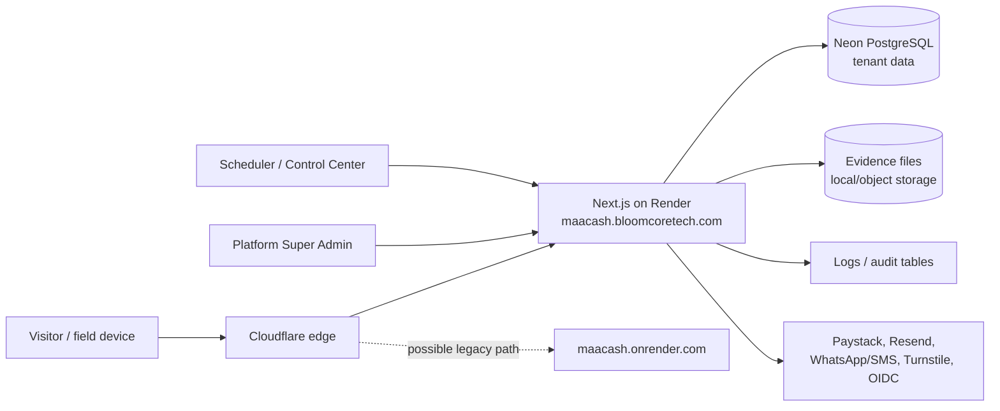
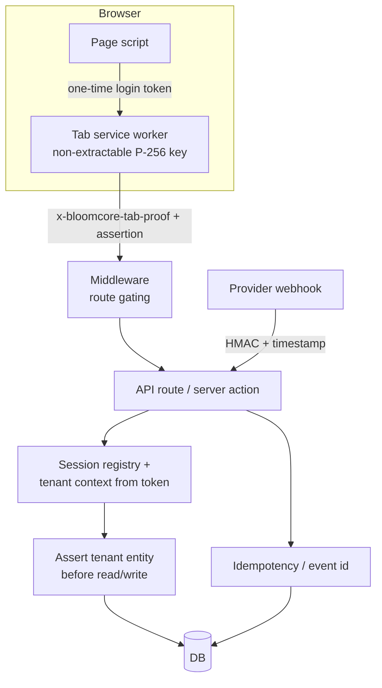

# Threat model — MaaCash / BIK Prestige Enterprise

**Version/date:** 2026-11-25. **Method:** STRIDE plus business abuse, evidence-based read-only review. **Standard:** BloomCore v1.0 (`BC-SEC-STD-001`), §4. **Reviewer:** security audit subagent. **Status:** working model, requires owner acceptance of residual risks. **Note:** this file complements the existing `THREAT-MODEL.md`; it does not replace it.

## Scope and diagrams

### System context

### Key data flow and trust boundaries

Trust boundaries: browser ↔ CDN, CDN ↔ origin (unverified bypass), origin ↔ database, origin ↔ providers, platform session ↔ tenant session, one tenant ↔ another tenant.

## Assets and trust boundaries

| Asset | Sensitivity | Located | Crossing |
|---|---|---|---|
| Tenant financial records, ledger, contributions, withdrawals | High | Neon PostgreSQL | API → DB, tenant → tenant, scheduler → DB |
| Customer identity and contact data | High | Neon PostgreSQL | Admin/worker/customer portal, exports |
| Evidence attachments | High | Evidence store, `GET /api/evidence/[id]` | Upload, authorized download, retention |
| Session tokens and per-tab private keys | High | Server session registry / browser CryptoKey | Header transport, service worker |
| Webhook signing secrets, JWT secret, provider keys | Critical | Provider secret manager / Render dashboard | CI, deployment, runtime |
| Platform admin authority | Critical | Separate platform session | `/platform/*`, OIDC, revocation API |
| Public marketing pages and metadata | Low | Public CDN cache | Anonymous visitors, crawlers |

## Threat register

| ID | STRIDE / business abuse | Affected component | Preconditions | Evidence class | Mitigation observed | Residual risk | Owner |
|---|---|---|---|---|---|---|---|
| T-01 | Spoofing — cross-tenant ID substitution (IDOR/BOLA) | `/api/user/[id]`, `/api/evidence/[id]`, export routes, server actions | Valid tenant session | Verified code | Tenant derived from session; `assertTenantEntity`; tenant-scoped queries; evidence SHA check | Runtime abuse tests not re-run here; new routes need tests | Engineering |
| T-02 | Elevation of privilege — tenant token used on platform | `/platform/*` | Valid tenant session | Verified code and live redirect | Platform claims require `kind:"platform"`, checked before tenant rules; separate session registry | Ruleset/branch controls unverified (GH-03) | Owner |
| T-03 | Spoofing — session theft or replay | Tab transport | XSS or stolen device | Verified code | Non-extractable P-256 proof, 120s assertion, server session registry, revocation | An XSS can use the key while the handle exists; CSP is essential | Engineering |
| T-04 | Tampering / repudiation — forged or replayed webhook | Paystack, SMS, WhatsApp webhooks | Attacker sends POST | Verified code | HMAC-SHA512/256 over raw body, timestamp tolerance 300s, rotation, `timingSafeEqual`, event-id dedupe | Production secret presence unverified (M-08) | Owner |
| T-05 | Denial of service — rate-limit bucket rotation | Auth, OTP, payment OTP endpoints | Direct origin access with forged CDN header | Likely | HMAC-keyed counters, fail-closed, user/tenant scopes | Origin bypass unverified; see API-01/DEP-02 | Owner |
| T-06 | Denial of service — expensive exports | `/api/zeli/analytics/export`, `/api/association/export`, `/api/audit` | Authenticated tenant admin | Verified | Authorization and bounded snapshot logic | No endpoint-specific rate limit (API-02) | Engineering |
| T-07 | Information disclosure — route map | `robots.txt` | Anonymous GET | Verified live | Auth still required on private routes | Sensitive prefixes published (RE-01) | Owner |
| T-08 | Information disclosure — browser source and env | Client bundle, source maps | Anonymous inspection | Verified live/code | No source maps, no secrets in `NEXT_PUBLIC_*`, no analytics SDK | Full chunk scan not performed (RE-03) | Engineering |
| T-09 | Tampering — CI dependency or action compromise | GitHub Actions | Upstream tag moved or maintainer compromised | Verified | Lockfile `npm ci`, Gitleaks, CodeQL, secret ignore rules | Unpinned actions, `allowed_actions: all`, disabled GitHub scanning (GH-01/GH-02) | Owner |
| T-10 | Tampering — unreviewed production deploy | `main` branch + `autoDeploy: true` | Direct push | Verified API / unverified ruleset | CI runs on push and PR | Classic protection off; rulesets unverified (GH-03) | Owner |
| T-11 | Repudiation — duplicate money movement | Offline sync, payments, revocation | Retry, timeout, concurrent submit | Verified code | Idempotency keys reserved before posting; unique constraints; transactional event id | Production load/concurrency not tested here | Engineering |
| T-12 | Denial of service / fraud — provider or queue outage | Paystack, Resend, WhatsApp, scheduler | Provider unavailable or slow | Partially verified | Disable-by-default delivery switches, allowlists, audit logs, maintenance guard | Alert routing and RTO/RPO unverified (DEP-07) | Owner |
| T-13 | Business abuse — unpaid paid-operations access | `enforcePaidOperations` in `src/lib/tenant.ts:285-308` | Tenant without active/grace subscription | Verified code | Blocks money operations but allows billing settlement; legacy tenants grandfathered | Grandfather rule needs owner acknowledgement | Product owner |
| T-14 | Business abuse — evidence tampering or wrong-subject disclosure | `GET /api/evidence/[id]` | Stored file modified or customer guesses id | Verified code | Id regex, tenant + subject ownership check, stored SHA-256 verification, audit log | Storage integrity at rest unverified | Engineering |

## Required threat questions

- **Changed ID, tenant ID, branch ID, role claim or amount?** Tenant and role come from the authenticated tab token; entity ids are checked with `assertTenantEntity`. Financial amounts are recalculated server-side in the reviewed flows. No direct client-supplied tenant id was found in reviewed routes. Residual: not every server action was read in full.
- **Replayed, duplicated, delayed or concurrent request?** Idempotency keys, unique references, event-id transactions and DB constraints exist in offline sync and revocation. Concurrency under production load was not tested.
- **Forged, repeated or out-of-order webhook?** HMAC with timestamp tolerance and event dedupe observed. Provider secret configuration state is unverified.
- **Connectivity lost before, during or after a write?** UI guidance and reservation-before-posting exist in offline flows. Weak-network behaviour was reviewed in source, not re-tested live.
- **What can an anonymous visitor or crawler observe?** Marketing pages, canonical metadata, `robots.txt` with internal prefixes, sitemap of public URLs, 401 from `/api/auth/session`, `{"status":"ready"}` from `/api/health/ready`. No authenticated data observed.
- **Malicious file, URL, export, search or imported dataset?** Evidence content-type/size/filename allow-list and path confinement; webhook body cap; JWK shape validation. SSRF-prone provider URLs are fixed constants in the DeepSeek client per existing audit notes; arbitrary configurable URLs are not enabled.
- **Dependency, CI credential or deployment identity compromise?** GH-01/GH-02/GH-03 are the open items. Lockfile and private repo are verified.
- **Database, email/SMS, payment, cache or region unavailable?** Health endpoints and maintenance guard exist; alert routing, backups and RTO/RPO are owner unverified.

## Residual risks and acceptance

| Residual risk | Compensating control | Owner | Expiry / trigger | Status |
|---|---|---|---|---|
| Direct origin bypass and IP-bucket spoofing | In-app scoped limits, HMAC-keyed counters, no XFF fallback | Owner (Render/Cloudflare) | Before next release; reassess on any hostname change | Unaccepted — M-03 |
| No evidenced WAF/bot/DDoS rules | Turnstile on auth flows, app rate limits, CSP | Owner (Cloudflare) | Before next release; reassess on edge config change | Unaccepted — M-02 |
| Unconfirmed branch protection | CI runs on push/PR; single admin collaborator | Owner (GitHub) | Before next release; reassess on collaborator change | Unaccepted — M-01 |
| Unpinned CI actions / disabled GitHub scanning | Gitleaks full history, CodeQL artifact, lockfile | Owner | Next maintenance window; reassess on workflow change | Open — M-05/M-06 |
| Expensive exports unthrottled | Authorization, bounded snapshot | Engineering | Next maintenance window; reassess on usage spike | Open — M-09 |
| Five E2E failures | 1828 unit tests pass; manual UAT not evidenced | Product owner | Before release sign-off | Open — M-04 |
| Current DB backups, network policy and region mismatch | Historical verified restore drill in deployment runbook | Owner (Neon/Render) | Next maintenance window; reassess on migration | Open — M-07 |
| Provider signing secrets and rotation unknown | Code verifies HMAC when secrets are present | Owner | Next maintenance window; reassess on provider rotation | Open — M-08 |

## Acceptance statement

This model must be reviewed and accepted by the product owner. Acceptance requires either completion or written risk acceptance (owner, compensating control, expiry, reassessment trigger) for every unaccepted residual above. A green test suite is not proof that the product is secure or production-ready. No deployment was authorised or performed by this audit.
