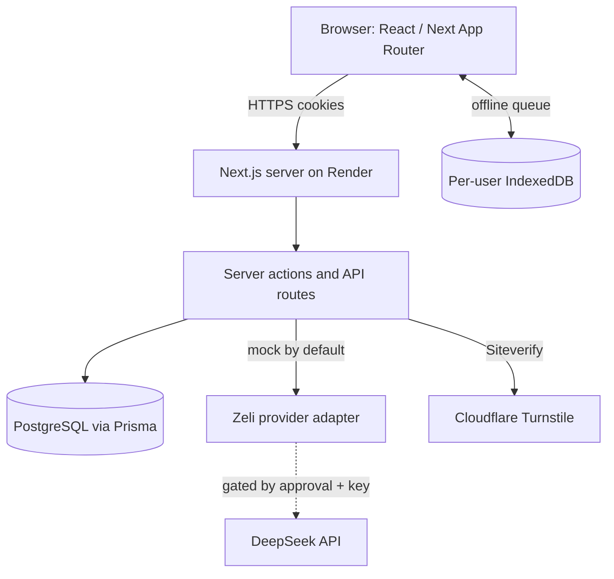

# 02 — Architecture and Data Flow

## Deployed topology (repository evidence)



The repository does not contain evidence of separate microservices, queues,
workers or a vector database. The application is deployed as the Render service
`bloomcore-one`. The legacy `bik-prestige-legacy` service is unrelated and out of
scope.

## Trust boundaries

1. **Public internet → Next.js**: TLS, security headers, public routes only.
2. **Tenant session → tenant data**: middleware + server-side tenant resolution.
3. **Platform session → tenant data**: one-way isolation; platform routes accept
   only the platform cookie.
4. **Browser → offline IndexedDB**: same-origin storage, scoped by tenant/user;
   not encrypted against device compromise.
5. **Application → AI provider**: disabled by default; approval gate.
6. **Application → Turnstile**: server-side Siteverify; browser widget result is
   not trusted.

## Authentication and sessions

- Passwords: bcrypt hashes; no plaintext storage.
- JWT session cookies per module, HttpOnly, SameSite=Lax, Secure in production,
  8-hour absolute/inactivity policy, `jti` server registry with revocation.
- MFA: TOTP (SHA-1, 6 digits, 30 s, ±1 step) plus hashed recovery codes.
  TOTP steps are consumed atomically (`mfaLastTotpStep`) to prevent replay.
- Login throttling: progressive 1/5/15-minute cooldown, account and
  account+IP dimensions; persistent database counters.
- Turnstile: server verification, action/hostname checks, single-use token
  ledger, fail-closed errors.
- Recovery: administrator-assisted hashed single-use codes; no email provider.

## Financial services

Contributions and withdrawals run in database transactions with row/account
locking, daily-rate validation, unique reference ids and allocation integrity.
Reversals are compensating rows. Remittances use an in-place reversal marker.
Daily accounts use immutable revision snapshots plus a corrected live row.

## Offline

`bik-prestige-offline:v2:<tenantId>:<userId>` stores a transaction queue,
customer cache, drafts and meta. Queue records carry tenant/user/device id,
stable idempotency key, status and canonical payload. Sync is claimed atomically,
retried with the same key, bounded by 401/429 handling, and coordinated across
tabs for closure before deletion.

## Zeli

Zeli resolves identity from the session, retrieves allow-listed tenant-scoped
read-only context, calls a provider adapter (mock by default), and persists the
conversation. The chat route is same-origin and authenticated. DeepSeek is inert
without written approval, an explicit flag and a secret key. Zeli has no
financial write tool.

## Sensitive data flows

- Browser ↔ server: session cookie, form data, financial inputs over HTTPS.
- Server ↔ database: tenant-scoped Prisma queries.
- Browser → IndexedDB: customer cache, drafts, pending transactions (scoped, not
  device-encrypted).
- Server ↔ AI: no tenant data unless the provider gate is open.
- Server ↔ Turnstile: challenge token only.

## External dependencies

Render (hosting), Neon/PostgreSQL, Cloudflare Turnstile, Google Fonts, optional
DeepSeek. No payment provider, email provider or object storage is integrated in
this candidate.

## Zeli Analytics addendum

New surfaces:

- `/admin/zeli-analytics` (entitled tenant admin)
- `/admin/zeli-analytics/upgrade` (denial)
- `/platform/zeli` (platform operator)
- `/api/zeli/analytics/export` (entitled tenant admin)

Data flow:

```
session → tenant context → role admin → live zeli_analytics entitlement
        → validated UTC period/branch → ZeliAnalyticsDaily aggregate
        → deterministic insights/templates → response with source and freshness
```

Aggregates are derived from contributions, withdrawals, remittances, daily
accounts, expenses, customers and collector assignments. Reversed records are
excluded. Aggregates are tenant-scoped and refreshed idempotently.

No external AI path exists. A future provider must use the deny-by-default
gateway described in
`docs/zeli/ZELI-PRIVACY-MINIMIZATION-AND-PROVIDER-GATEWAY.md`.

## Zeli commerce and provider addendum

```
Tenant admin → checkout action → server catalogue price
             → Paystack initialize → hosted checkout
             → signed webhook → payment event (unique) → subscription active
             → zeli_analytics entitlement (expiry) → analytics workspace
```

The callback return re-verifies server-side. A redirect alone never activates
access. Refund, cancellation, expiry and manual suspension have distinct states.

External AI:

```
local snapshot → typed aggregate insight package → gateway
→ global policy (disabled/synthetic/approved) → fixed DeepSeek endpoint
→ strict output validation → local authoritative facts + labelled explanation
```

No raw conversation, record, exact value or identifier is sent. The global
emergency stop overrides every other setting.

## Entire-Zeli master switch addendum

A singleton database row (`ZeliAvailability`) is read on every Zeli request.
It is independent of `ZeliProviderControl` and tenant entitlements.

- Missing row or database error → Zeli disabled (fail closed).
- Migration inserts an enabled row for existing installations.
- No cache; disabling applies immediately across instances.
- Enforced in pages, chat API, conversations, analytics actions, export and
  checkout; **not** in webhooks, subscription lifecycle, platform controls or
  unrelated platform features.
