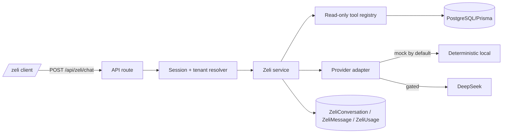

# Zeli — Architecture

## Flow

## Components

- `src/lib/zeli/types.ts` — identity, tool, provider contracts.
- `src/lib/zeli/tools.ts` — allow-listed read-only tools. Tenant always comes
  from the server session; the model/browser cannot supply it.
- `src/lib/zeli/service.ts` — ownership, usage, context, provider call, message
  persistence, title update.
- `src/lib/zeli/provider.ts` — provider selection; mock by default.
- `src/lib/zeli/mock-provider.ts` — deterministic local answers from context.
- `src/lib/zeli/deepseek-provider.ts` — inert until approval + key + explicit
  provider selection.
- `src/lib/actions/zeli.actions.ts` — conversation CRUD, feedback, bootstrap.
- `src/app/api/zeli/chat/route.ts` — same-origin, authenticated, streamed turn.
- `src/app/zeli/page.tsx` — workspace UI.

## Persistence

`ZeliConversation` (tenantId, userId, title, soft-delete marker),
`ZeliMessage` (role, content, sources JSON, tool metadata, provider/model,
feedback) and `ZeliUsage` (per tenant/user/day). Messages cascade on delete.

## Streaming

The server completes grounding and generation, then streams the grounded text.
Stop aborts the client read; no partial answer is presented as complete.
